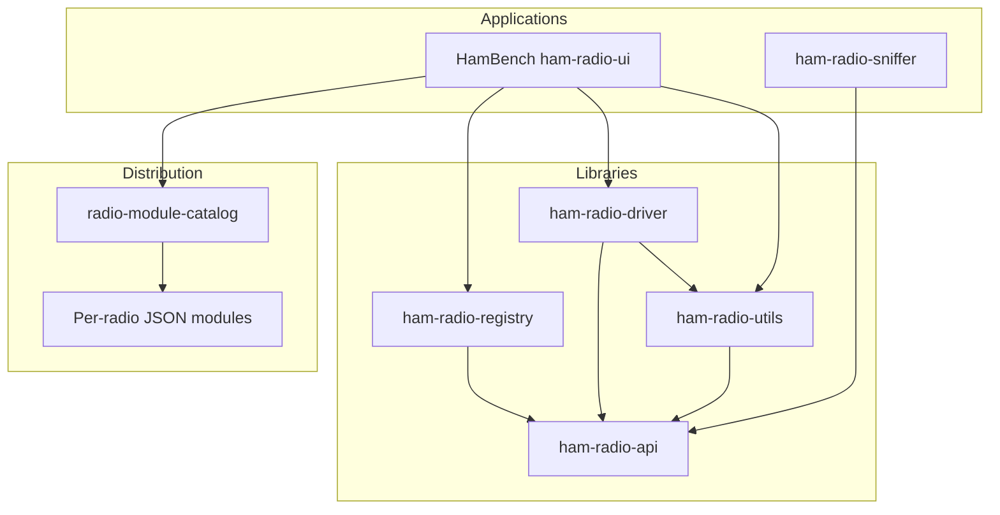

# Architecture Overview

HamBench programs a radio from JSON. The desktop app, the generic driver, and the memory-map codec live in the Springfield libraries. A radio module ships the protocol, schemas, and memory map for one radio. It does not ship a TypeScript driver or a codec.

## Pieces

- **ham-radio-api**: Types and JSON schemas shared by the other libraries (protocol steps, memory map, serial config, stations, antennas).
- **ham-radio-driver**: Generic driver. It runs the protocol steps in a radio config against a serial port.
- **ham-radio-utils**: `createMemoryMapCodec()`, schema validation, band plan, and the pack scripts modules call.
- **ham-radio-registry**: Parses and validates a radio config and a catalog document. HamBench uses this to check JSON. It is not a plugin loader.
- **radio-module-catalog**: GitHub catalog ([schema version 3](/developer/adr/0009-per-radio-modules)). One entry is one radio zip.
- **Radio modules**: One JSON zip per radio (`radio-module-<modelId>-<version>.zip`), built from a manufacturer repo such as [radio-module-baofeng](https://github.com/springfield-ham-radio/radio-module-baofeng).
- **HamBench** (`ham-radio-ui`): Desktop app. It downloads catalog zips, keeps the JSON, and calls the driver and the memory-map codec.
- **ham-radio-sniffer**: Headless serial bridge for capturing traffic. See [ADR 0001](/developer/adr/0001-rewrite-sniffer-in-rust).

## High-Level Architecture Diagram

## Key Relationships

- **ham-radio-api** is the contract. The driver, utils, registry, and the desktop app depend on its types.
- **ham-radio-driver** executes `readMemory` and `writeMemory` steps. It does not embed a protocol for a specific radio.
- **ham-radio-utils** turns a memory-map JSON file into bytes. HamBench calls `createMemoryMapCodec()` when the config says to.
- **ham-radio-registry** checks catalog entries and radio JSON (`parseModuleCatalog`, `validateConfiguration`). Official modules are not discovered from npm or from `node_modules`.
- **radio-module-catalog** points HamBench at a zip on GitHub Releases. One config file is one catalog entry.
- **Radio modules** are data. Shipping configs set `codec.type` to `"memoryMap"` and `$ref` a memory map. That field is what [ADR 0004](/developer/adr/0004-radio-modules-json-only) requires and what Baofeng and Kenwood ship. It is not a property of `radio-protocol-schema.json`. The schema does not list `codec` and does not set `additionalProperties: false`, so Ajv accepts the field without restricting its value. The registry type still allows older `"shared"` and `"inline"` experiments. New modules must not use those.
- **HamBench** downloads the zip, drops everything that is not JSON, runs the protocol with the generic driver, and encodes or decodes with `createMemoryMapCodec()`. No TypeScript from the module is imported.
- **ham-radio-sniffer** captures serial traffic. It is not on the read/write path inside the desktop app.

## Why this shape

A new radio is a JSON module and a catalog entry. The driver and the codec stay in the libraries, so module authors do not publish a plugin or a codec factory. Third-party modules use the same zip layout ([ADR 0012](/developer/adr/0012-community-drivers)).

## Next steps

- [Build a radio driver](/developer/build-a-radio-driver)
- [Architecture reference](/developer/architecture)
- [Radio config reference](/developer/config-reference)
