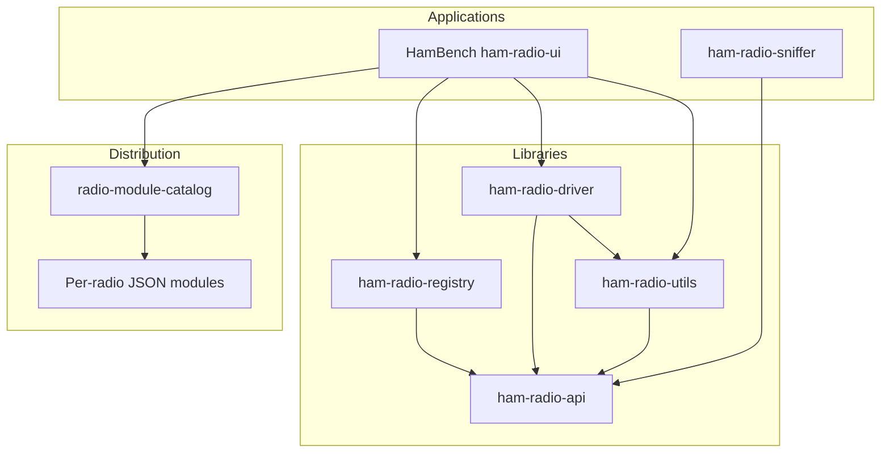
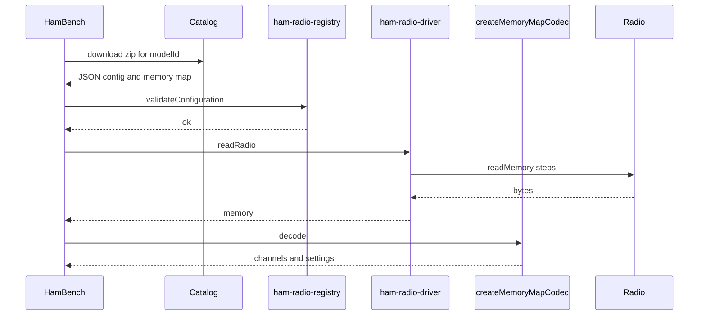
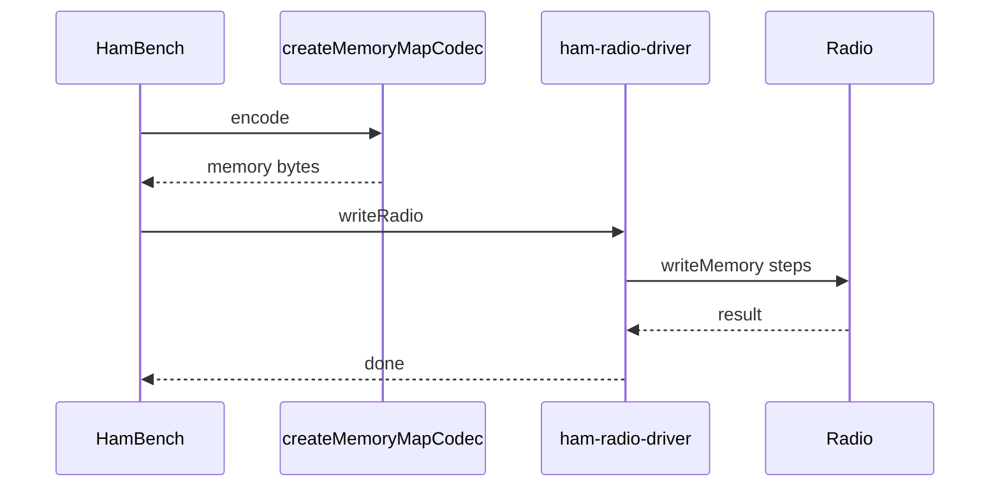
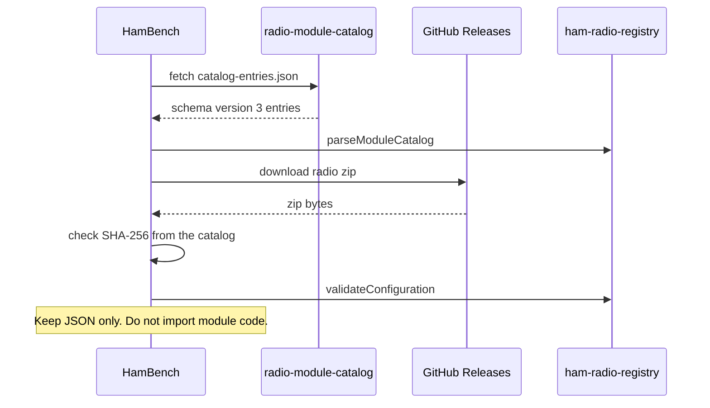

# HamBench Architecture Reference

> **Looking for a high-level introduction?** See the [Architecture Overview](/developer/architecture-overview) in the Getting Started section.

This document provides a comprehensive technical reference for the HamBench software ecosystem architecture, including detailed analysis of module responsibilities, APIs, data flow, design patterns, security, performance, and extensibility.

## System Overview

HamBench is a desktop app plus a set of libraries. Radio support is a JSON module listed in the GitHub catalog. There is no CLI product and no HTTP API server in this architecture.



## Module Analysis

### 1. **@springfield/ham-radio-api** - Core Type Definitions

**Purpose**: Provides the foundational type system and interfaces that define the entire ecosystem.

**Key Responsibilities**:
- Define core data types and interfaces for radio operations
- Provide branded types for type safety (Frequency, RadioChannelId, etc.)
- Define radio communication protocols and memory structures
- Establish the contract between all other modules

**Core Components**:
- **Branded Types**: Type-safe identifiers for frequencies, channels, models, etc.
- **Radio Interfaces**: `RadioDriver`, `RadioCodec`, `RadioMemory`, etc.
- **Spectrum Management**: Band, mode, and privilege definitions
- **License Management**: Amateur radio license class definitions
- **Stations and antennas**: `RadioStation`, `StationAntenna`, generic `AntennaType` catalog

**Key Exports**:
```typescript
// Core radio interfaces
export interface RadioDriver {
  readRadio(serialPortPath: string, progressIndicator: RadioProgressIndicator): Promise<RadioMemory>;
  writeRadio(serialPortPath: string, memory: RadioMemory, progressIndicator: RadioProgressIndicator): Promise<void>;
}

export interface RadioCodec {
  decode(memory: RadioMemory): RadioProgram;
  encode(program: RadioProgram, memory: RadioMemory): RadioMemory;
}

// Branded types for type safety
export type Frequency = Brand<number, 'Frequency'>;
export type RadioChannelId = Brand<string, 'RadioChannelId'>;
export type RadioModelId = Brand<string, 'RadioModelId'>;
```

**Dependencies**: Minimal - only `loglayer` and `ts-brand` for logging and type safety.

### 2. **@springfield/ham-radio-driver** - Protocol Interpreter

**Purpose**: Implements the core radio communication logic using a DSL-based protocol system.

**Key Responsibilities**:
- Execute radio communication protocols defined in JSON
- Handle serial port communication with radios
- Manage protocol step execution and error handling
- Provide progress tracking and cancellation support

**Core Components**:
- **RadioDriver**: Main driver class for reading/writing radio memory
- **ProtocolInterpreter**: Executes protocol steps defined in configuration
- **Step Executors**: Specialized executors for different protocol operations
- **Serial Communication**: Handles low-level serial port operations

**Key Features**:
```typescript
export class RadioDriver {
  async readRadio(serialPortPath: string, progressIndicator: RadioProgressIndicator): Promise<Uint8Array>
  async writeRadio(serialPortPath: string, data: Uint8Array, progressIndicator: RadioProgressIndicator): Promise<void>
}

export class ProtocolInterpreter {
  async executeProtocol(protocol: any, operation: 'readMemory' | 'writeMemory', buffer?: Uint8Array): Promise<void>
}
```

**Step Executors** (see [ADR 0002](./adr/0002-protocol-dsl.md)):
- `CatReadExecutor`: Live CAT memory read loops
- `CatWriteExecutor`: Live CAT memory write loops
- `ReadExecutor`: Chunked memory read
- `WriteExecutor`: Chunked memory write
- `ExchangeExecutor`: Send / expect / baud / delay exchanges

**Dependencies**: `@springfield/ham-radio-api`, `@springfield/ham-radio-utils`, `serialport`, `loglayer`

### 3. **@springfield/ham-radio-utils** - Shared Utilities

**Purpose**: Provides common utilities, data structures, and helper functions used across the ecosystem.

**Key Responsibilities**:
- Memory management and data conversion utilities
- Schema validation and JSON processing
- UI logging and progress reporting
- Test data factories and utilities
- Band plan and frequency management
- Operator-class mapping for FCC / Callook license lookups

**Core Components**:
- **Memory Utilities**: `SegmentedMemory`, memory data conversion functions
- **Schema Validation**: JSON schema validation using Ajv
- **UI Logging**: Progress reporting and command-level logging
- **Data Conversion**: BCD conversion, hex formatting, frequency display
- **Band Plan**: Band lookup and license-class privilege checks (`BandPlan.hasPrivilege`)
- **License Mapping**: `operatorClassToLicenseClassId` for Callook / FCC operator classes
- **Test Utilities**: Factory classes for generating test data

**Key Features**:
```typescript
// Memory management
export class SegmentedMemory {
  constructor(segments: MemorySegment[])
  getSegment(index: number): Uint8Array
  setSegment(index: number, data: Uint8Array): void
}

// Schema validation
export function validateSchema(data: any, schema: any): ValidationResult

// UI logging
export interface UILogger {
  startCommand(stepIndex: number, totalSteps: number, operation: string, step: any): void
  logCommandSuccess(stepIndex: number, totalSteps: number, operation: string, step: any, context: any): void
  logCommandFailure(stepIndex: number, totalSteps: number, operation: string, step: any, error: Error, context: any): void
}
```

**Dependencies**: `@springfield/ham-radio-api`, `ajv`, `fishery`, `loglayer`, `sprintf-js`

### 4. **@springfield/ham-radio-registry** - Catalog and config checks

**Purpose**: Parse and validate radio JSON and the official catalog. HamBench calls this library. It does not load a radio by scanning npm.

**Key responsibilities**:
- `parseModuleCatalog` reads a schema version 3 catalog. One entry is one radio.
- `validateConfiguration` checks the radio config HamBench is about to use.
- `isApiVersionCompatible` compares the app's `@springfield/ham-radio-api` version with the module's `minApiVersion`.

**What HamBench does not do with this package**:
- It does not call `discoverConfigurations()`, `installPlugin()`, or `getCodec()`.
- It does not resolve a `codecFactory` path inside a module zip.
- Official zips are not npm packages. See [ADR 0005](./adr/0005-module-distribution-github-catalog.md) and [ADR 0009](./adr/0009-per-radio-modules.md).

`@springfield/ham-radio-registry/node` still exports `NpmBasedConfigRegistry` for Node workspace experiments. That entry scans `node_modules` for `springfield.pluginType`. The desktop app does not use it to install radios.

**Dependencies**: `@springfield/ham-radio-api`, `loglayer`

### 5. **radio-module-catalog** and the JSON modules

**Purpose**: Publish one zip per radio and an index HamBench can download.

The catalog repo holds `catalog-entries.json` (schema version 3). Each entry names a `radio-module-<modelId>-<version>.zip` on GitHub Releases, plus a SHA-256 integrity hash. Manufacturer repos such as `radio-module-baofeng` are where the JSON is written. The catalog `package` name (`@springfield/radio-module-baofeng-uv5r`) is an identifier, not an npm coordinate.

**What a module contains**:
- `configs/<modelId>.json` with the protocol, serial settings, and a `codec` object
- Shared channel and settings schemas
- A memory map referenced by `memoryMap.$ref`

`codec.type` in every shipping Baofeng and Kenwood config is `"memoryMap"`. [ADR 0004](./adr/0004-radio-modules-json-only) requires that for new modules. `radio-protocol-schema.json` does not declare `codec` and does not set `additionalProperties: false`, so Ajv does not require the field and does not limit it to an enum. HamBench still treats `"memoryMap"` as the signal to call `createMemoryMapCodec()` in `@springfield/ham-radio-utils`. Older registry types also mention `"shared"` and `"inline"`. New modules must not use those.

Encode and decode is not code in the module. The generic driver in `@springfield/ham-radio-driver` runs the protocol steps.

## Data flow

### Read memory



### Write memory



### Install a module



## How the libraries fit together

The driver selects a step executor for each protocol step ([ADR 0002](./adr/0002-protocol-dsl.md)): `CatReadExecutor`, `CatWriteExecutor`, `ReadExecutor`, `WriteExecutor`, and `ExchangeExecutor`. Those executors live in ham-radio-driver. A module cannot register another one.

`createMemoryMapCodec()` is the only codec a new module uses. There is no `CodecFactory` in the module zip.

Progress reporting uses `RadioProgressIndicator` (`setValue`, `isCanceled`) from the API. The driver checks it between steps.

## Security

- HamBench validates a config with `validateConfiguration` before use.
- The catalog entry carries a SHA-256 integrity hash. The app checks the zip before install ([ADR 0005](./adr/0005-module-distribution-github-catalog.md)).
- A module zip is JSON. The app does not execute it.
- Branded types in ham-radio-api keep frequencies, channel ids, and model ids distinct. External JSON is still checked at runtime.

## Performance

- Protocol steps run one at a time against the open serial port. The driver can cancel when the progress indicator says so.
- Segmented memory keeps large radio images addressable without copying the whole image for every step.
- The app holds the parsed config for the installed radio. It does not re-download the catalog on every read.

## Extensibility

1. **New radio**: Add a JSON module and a catalog entry. Start from [radio-module-template](https://github.com/springfield-ham-radio/radio-module-template). See [Build a radio driver](/developer/build-a-radio-driver).
2. **New protocol step kind**: Add an executor in ham-radio-driver and ship it with the app. Modules only name steps the driver already knows.
3. **Third-party modules**: Same zip layout as official modules ([ADR 0012](./adr/0012-community-drivers)). They are not npm plugins.

## See also

- [Architecture overview](/developer/architecture-overview)
- [Module layout](/developer/radio-module-dev)
- [Publish a module](/developer/publishing-modules) 
